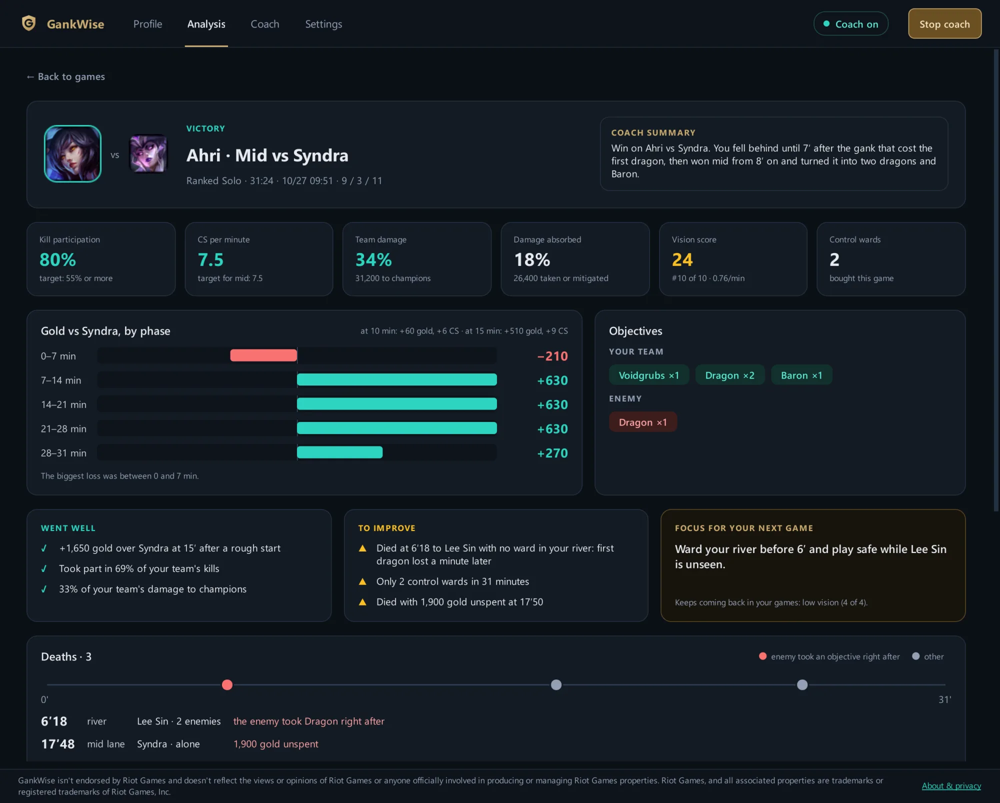
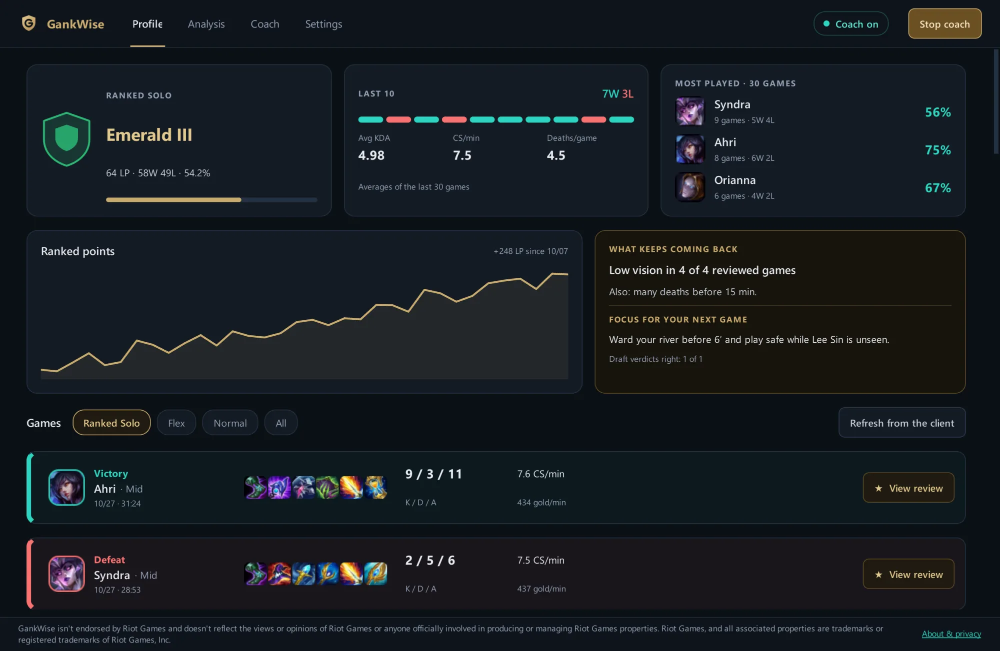

  

<h1 align="center">GankWise</h1>

  <strong>Your AI coach for every League of Legends game.</strong> 
  Draft help, a voice coach, enemy scouting and post-game reviews, right on your desktop.

  <a href="https://github.com/marciomvm/gankwise-releases/releases/latest"><strong>⬇ Download for Windows</strong></a>
  &nbsp;·&nbsp;
  <a href="https://gankwise.com">gankwise.com</a>
  &nbsp;·&nbsp;
  <a href="https://gankwise.com/report">Report a bug</a>
  &nbsp;·&nbsp;
  <a href="#português">Português</a>

---

This repository hosts the official **GankWise** downloads and release notes. GankWise is in
**open beta**: it is free while the beta lasts, and the first players to sign in get a spot.
When the beta is full, [gankwise.com](https://gankwise.com) takes your email for the waitlist.

  

## What it does

| | |
| --- | --- |
| **Champion select** | A verdict on your draft, a pick suggestion and runes for your champion, applied to the client in one click. |
| **Voice coach** | Hold a key, ask a question during the game, hear a short answer. It reads only what the game already shows you. |
| **Enemy scouting** | At the loading screen, one tip per opponent from their public rank and recent games. Players with hidden names are skipped. |
| **Post-game review** | Gold against your lane opponent by phase, deaths on a timeline, objectives, what went well and one focus for the next game. |
| **Profile & trends** | Your rank and LP climb, your mains, and the habit that keeps costing you games. |

The coach suggests; it never plays for you and never shows information the game hides.

  

## Install

**Requirements:** Windows 10 or 11 (64-bit) and the League of Legends client.

1. Download **`GankWise-Setup.exe`** from the [latest release](https://github.com/marciomvm/gankwise-releases/releases/latest)
   and run it. No admin password needed; it adds a Start menu shortcut and an uninstaller.
2. Windows may show *"Windows protected your PC"* because the beta is not code-signed yet:
   click **More info › Run anyway**.
3. Click **Sign in** (Google or email). That is all: no API keys to set up.

To update, run a newer Setup over it: your history, settings and sign-in stay. Prefer no
installer? The release also has **`GankWise.zip`**: unzip it and open `GankWise.exe`.

GankWise lives in the system tray. Open League as usual; the coach starts with the game.

## Privacy

Your match history stays on your PC. Questions, voice and game data go to the GankWise server
and its AI providers only to answer you, and are never sold. Read the full
[Privacy Policy](https://gankwise.com/privacy) and [Terms of Use](https://gankwise.com/terms).

## Support

- **Bugs and ideas:** the **Report** tab in the app (it can attach the app log), or
  [gankwise.com/report](https://gankwise.com/report).
- **Email:** [support@gankwise.com](mailto:support@gankwise.com)

---

## Português

**Seu coach de IA para cada partida de League of Legends.** Ajuda no draft, coach por voz,
scouting do inimigo e análise pós-jogo, direto no seu PC.

O GankWise está em **beta aberto**: é grátis durante o beta, e os primeiros jogadores que
entrarem garantem uma vaga. Quando lotar, o site [gankwise.com](https://gankwise.com) recebe
seu e-mail para a lista de espera.

**Como instalar**

1. Baixe o **`GankWise-Setup.exe`** na [versão mais recente](https://github.com/marciomvm/gankwise-releases/releases/latest)
   e abra. Não pede senha de administrador; cria atalho no Menu Iniciar e desinstalador.
2. Se o Windows mostrar *"O Windows protegeu o computador"*, clique em
   **Mais informações › Executar assim mesmo** (o beta ainda não tem assinatura digital).
3. Clique em **Entrar** (Google ou e-mail). Pronto: nenhuma chave para configurar.

Para atualizar, rode o Setup novo por cima: histórico, configurações e login continuam.

Requisitos: Windows 10 ou 11 (64 bits) e o cliente do League of Legends.

Bugs e sugestões: aba **Reportar** no app ou [gankwise.com/report](https://gankwise.com/report).
Privacidade: [gankwise.com/privacy](https://gankwise.com/privacy?lang=pt).

---

GankWise isn't endorsed by Riot Games and doesn't reflect the views or opinions of Riot
Games or anyone officially involved in producing or managing Riot Games properties. Riot Games,
and all associated properties are trademarks or registered trademarks of Riot Games, Inc.

© 2026 GankWise. The app includes open-source software; see
[THIRD_PARTY_NOTICES.md](THIRD_PARTY_NOTICES.md).
